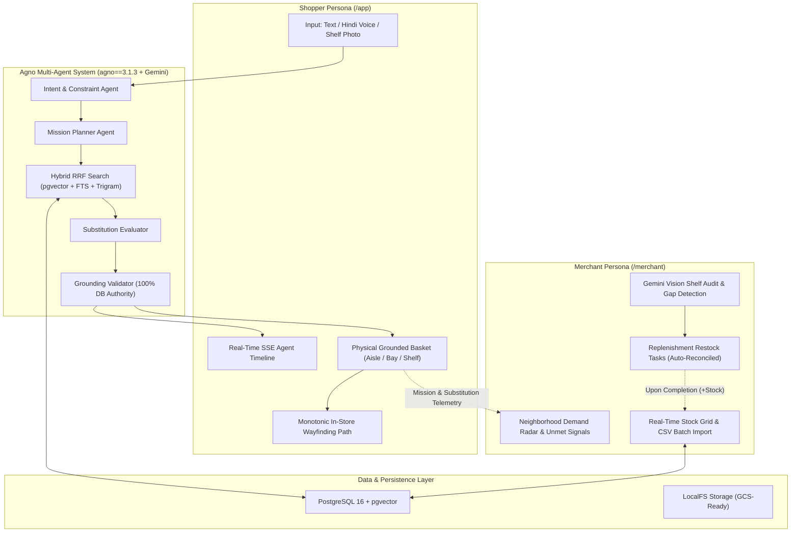

# OmniMission AI 🛒✨
**Multimodal Goal-Driven Phygital Commerce Engine**  
*Built for the Google AI Hackathon — Phase 1 (Local-First, GCP-Ready)*

[](https://github.com/omnimission/omnimission-ai/actions)
[](https://fastapi.tiangolo.com)
[](https://nextjs.org)
[](https://agno.com)
[](https://ai.google.dev)
[](https://github.com/pgvector/pgvector)
[](https://www.typescriptlang.org)

---

## 1. Product Overview & Problem Statement

**Hackathon Problem Statement:**
> *Build an AI-powered solution that transforms how businesses understand, engage, and serve customers while improving operational efficiency across physical and digital commerce.*

Traditional ecommerce applications show static, flat catalogs without understanding real human goals, and disconnect shoppers from the physical retail inventory situated within 2 kilometers of their homes. When a customer wants to host an 8-person dinner party, prepare an eggless high-protein cake, or purchase travel-sized toiletries compliant with airline rules, they must manually search dozens of individual ingredients and guess whether local stores actually have them in stock.

**OmniMission AI** bridges this physical-digital ("phygital") gap through a dual-sided platform:
- **Shoppers (`user`):** State fuzzy goals in text, multi-lingual voice (Hindi, Tamil, Kannada), or photos. An autonomous **Agno** multi-agent workflow powered by **Google Gemini** decomposes the intent into required ingredients, performs hybrid vector + full-text search against the physical inventory of nearby stores, proposes dietary-aligned substitutes when items are out of stock, resolves exact in-store shelf coordinates (`Aisle`, `Bay`, `Shelf`), and generates a monotonic walking path.
- **Merchants (`merchant`):** Operate a real-time command portal providing neighborhood demand radar (tracking trending searches and out-of-stock substitution revenue loss), live shelf inventory management, automated AI vision shelf audits via Gemini Vision, and replenishment restock task workflows that atomically reconcile inventory upon stocking.

---

## 2. System Architecture



---

## 3. Tech Stack & Versioning

| Component | Technology | Version | Purpose |
| :--- | :--- | :--- | :--- |
| **Multi-Agent Orchestrator** | **Agno** | `3.1.3` (pinned) | Agent execution, structured output schemas, workflow graph |
| **AI Foundation Models** | **Google Gemini** | `gemini-2.0-flash` / `2.5-flash` | Intent extraction, recipe expansion, audio transcription, vision audits |
| **Backend Framework** | **FastAPI** | `0.115+` | High-performance async REST API, SSE streaming, dependency injection |
| **Database & Vectors** | **PostgreSQL** + **pgvector** | `16.0` / `pgvector 0.7` | Relational persistence, dense 768d embeddings, trigram similarity |
| **ORM & Migrations** | **SQLAlchemy** + **Alembic** | `2.0+` / `1.14+` | Async declarative models, transactional migrations |
| **Password Hashing** | **Argon2id** (`argon2-cffi`) | `23.1+` | GPU-resistant cryptographic credential hashing |
| **Frontend Framework** | **Next.js** | `15.5+` (App Router) | Server-side rendering, React 19, strict TypeScript compilation |
| **State Management** | **TanStack Query** + **Zustand** | `v5` / `v5` | Async server cache synchronization & local client state |
| **Styling & Design System** | **Tailwind CSS** + **Radix UI** | `3.4+` | Accessible design tokens, responsive typography, dark mode |

---

## 4. 5-Minute Quickstart

### Prerequisites
- [Docker & Docker Compose](https://www.docker.com/)
- [uv](https://docs.astral.sh/uv/) (Fast Python package manager)
- [Node.js](https://nodejs.org/) v20+ & npm

### 1. Clone & Configure Environment
```bash
git clone https://github.com/omnimission/omnimission-ai.git
cd omnimission-ai
cp .env.example .env
# Optional: Add GOOGLE_API_KEY in .env to use live Gemini models
# (Deterministic offline fallback runs automatically without an API key)
```

### 2. Start PostgreSQL with pgvector
```bash
make db
# Starts pgvector/pgvector:pg16 container on localhost:5432
```

### 3. Apply Migrations & Deterministic Seed Data
```bash
make migrate
make seed
# Seeds 4 demo accounts, 7 stores across 4 Indian metros, and 28 rich catalog items
```

### 4. Start Development Stack
```bash
# Terminal 1: Backend API
make dev-api
# API available at http://localhost:8000
# OpenAPI Docs: http://localhost:8000/docs

# Terminal 2: Web Frontend
make dev-web
# Web UI available at http://localhost:3000
```

---

## 5. Demo Personas & Pre-Seeded Accounts

| Persona | Email | Password | Role | Pre-Seeded City & Stores |
| :--- | :--- | :--- | :--- | :--- |
| **Shopper (Arjun)** | `shopper@omnimission.ai` | `Shopper123!` | `user` | Bengaluru (Indiranagar, Koramangala) |
| **Merchant (Rajesh)** | `merchant@omnimission.ai` | `Merchant123!` | `merchant` | OmniMart Indiranagar 100ft Road |
| **Shopper 2 (Priya)** | `shopper2@omnimission.ai` | `Shopper123!` | `user` | Hindi Voice Shopper |
| **Merchant 2 (Pooja)** | `merchant2@omnimission.ai` | `Merchant123!` | `merchant` | OmniFresh Bandra West (Mumbai) |

---

## 6. Testing, Verification & Linting

```bash
# Run backend test suite (47 unit, integration, and agent-eval tests)
make test

# Run code style, formatting, and type checks
make lint
make typecheck

# Build and verify production Next.js frontend bundle
cd apps/web && npm run build
```

---

## 7. Environment Variables Reference

| Variable | Default Value | Description |
| :--- | :--- | :--- |
| `ENVIRONMENT` | `development` | Deployment environment (`development`, `test`, `production`) |
| `PORT` | `8000` | Backend API listen port |
| `DATABASE_URL` | `postgresql+psycopg://...` | PostgreSQL async connection string with psycopg 3 |
| `JWT_SECRET_KEY` | `dev-secret-...` | Secret key for signing HMAC-SHA256 access tokens |
| `GOOGLE_API_KEY` | `""` | Optional Google API Key for live Gemini 2.0 / 2.5 inference |
| `NEXT_PUBLIC_API_BASE_URL`| `http://localhost:8000` | Frontend backend API URL |

---

## 8. Documentation Index

- [System Architecture & Hexagonal Ports](docs/ARCHITECTURE.md)
- [Multi-Agent System & Grounding Design](docs/AGENTS.md)
- [REST API & SSE Event Contract](docs/API.md)
- [PostgreSQL Data Model & ERD](docs/DATA_MODEL.md)
- [Frontend Architecture & Design Tokens](docs/FRONTEND.md)
- [GCP Migration Playbook & Terraform Sketch](docs/GCP_MIGRATION.md)
- [Judge Demo Walkthrough & Golden Playbook](docs/DEMO.md)
- [Architecture Decision Records (ADRs)](docs/adr/)
- [Release Changelog](CHANGELOG.md)
