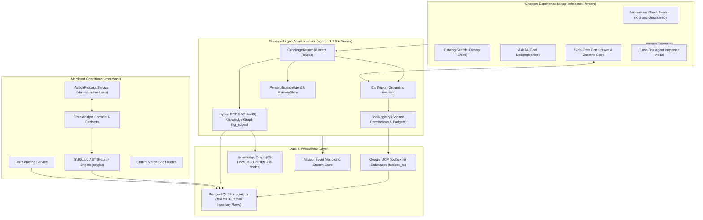

# OmniMission AI 🛒✨
**Multimodal Goal-Driven Phygital Commerce Engine**  
*Built for the Google AI Hackathon — Phase 2: The Agentic Intelligence Layer (v0.2.0)*

[](https://github.com/omnimission/omnimission-ai/actions)
[](https://fastapi.tiangolo.com)
[](https://nextjs.org)
[](https://agno.com)
[](https://ai.google.dev)
[](https://github.com/pgvector/pgvector)
[](https://www.typescriptlang.org)
[](https://github.com/omnimission/omnimission-ai)
[](docs/EVALUATION.md)
[](docs/EVALUATION.md)

---

## 1. Product Overview & Problem Statement

**Hackathon Problem Statement:**
> *Build an AI-powered solution that transforms how businesses understand, engage, and serve customers while improving operational efficiency across physical and digital commerce. Suggested GCP: Gemini on Vertex AI, Vertex AI Search / Agent Search, BigQuery + BigQuery AI, Cloud Run, Cloud Storage, AlloyDB/Cloud SQL, Looker.*

Traditional ecommerce applications show static, flat catalogs without understanding real human goals, and disconnect shoppers from the physical retail inventory situated within 2 kilometers of their homes. When a customer wants to host an 8-person dinner party, prepare an eggless high-protein cake, or purchase travel-sized toiletries compliant with airline rules, they must manually search dozens of individual ingredients and guess whether local stores actually have them in stock.

**OmniMission AI** bridges this physical-digital ("phygital") gap through a dual-sided platform powered by an agentic intelligence harness:
- **Shoppers (`user` & anonymous guests):** State fuzzy goals in text, multi-lingual voice (Hindi, Tamil, Kannada), or photos. An autonomous **Agno** multi-agent workflow powered by **Google Gemini** decomposes the intent into required ingredients, performs hybrid vector + full-text search against the physical inventory of nearby stores, proposes dietary-aligned substitutes when items are out of stock, resolves exact in-store shelf coordinates (`Aisle`, `Bay`, `Shelf`), generates a monotonic walking path, and adds items directly to a cart with guest session persistence and seamless checkout.
- **Merchants (`merchant`):** Operate a real-time command portal providing neighborhood demand radar (tracking trending searches and out-of-stock substitution revenue loss), live shelf inventory management, automated AI vision shelf audits via Gemini Vision, replenishment restock task workflows, and an autonomous **Store Analyst** with guarded natural-language-to-SQL (NL2SQL), proactive daily briefings, and Human-in-the-Loop (HITL) action proposals.

---

## 2. Phase 2 Agentic Intelligence Layer Highlights

Phase 2 transforms OmniMission AI from an app with an LLM call into a genuinely agentic, retrieval-grounded, tool-governed commerce engine:

1. **Guest-First Conversational Commerce (`/shop`):**
   - Unauthenticated shoppers immediately search physical catalog items with instant dietary filter chips or switch to **Ask AI** mode.
   - Goals are decomposed, mapped to physical in-stock inventory across selected stores, and added directly to a synchronized slide-over cart.
   - Anonymous cart persists via `X-Guest-Session-ID` and merges into the user profile upon checkout/authentication.
   - Mock checkout flow (`/checkout`) supporting simulated UPI, Card, NetBanking, and Cash on Delivery with full order history and in-store aisle maps (`/orders/[id]`).

2. **Governed Agent Harness & Cart Agent:**
   - **`ConciergeRouter`:** 8-route intent router directing queries to specialized sub-agents (`recipe`, `travel`, `party`, `cart_action`, `order_status`, `merchant_analytics`, `general_faq`, `catalog_search`).
   - **`CartAgent`:** Autonomous agent manipulating carts while strictly enforcing the **Physical Grounding Invariant** (100% DB authority, real prices, validated aisle coordinates).
   - **`ToolRegistry`:** Fine-grained governance enforcing permission scopes (`catalog:read`, `cart:write`, `store:read`, `merchant:analytics`, `knowledge:read`), side-effect risk classification (`read`, `idempotent_write`, `mutating`), and token budgets.
   - **`PersonalisationAgent` & `MemoryService`:** Dynamic memory store capturing shopper dietary restrictions and family preferences with full REST control (`/api/v1/memories`).

3. **Advanced RAG v2 & GraphRAG-Lite:**
   - Curated 65-document knowledge base with 192 structure-aware chunks across 4 corpora: Culinary Recipes, Curated Trip Kits, House Party Guides, and Dietary Replacement Matrices.
   - Hybrid retrieval fusing PostgreSQL tsvector (lexical FTS) and pgvector (dense semantic vectors) with Reciprocal Rank Fusion ($k=60$).
   - Recursive Knowledge Graph traversal via `kg_nodes` and `kg_edges` (`requires`, `satisfies_diet`, `substitutes_for`) guaranteeing deterministic ingredient and dietary substitution retrieval.

4. **Google MCP Toolbox for Databases:**
   - Database tool layer adhering to Google's MCP Toolbox architecture with parameterised SQL view tools (`v_store_stock_overview`, `v_aisle_traffic`, `v_daily_demand_aggregates`, `v_shrinkage_summary`).
   - Scoped to read-only Postgres role `toolbox_ro` with zero schema modification privileges.

5. **Resumable SSE Protocol over HTTP/2:**
   - Monotonic sequence IDs on `mission_events` table guaranteeing zero lost or duplicated events across network disconnects.
   - Supports `Last-Event-ID` HTTP header for seamless reconnection and historical replay.
   - Caddy reverse proxy configured with `flush_interval -1` and native HTTP/2 streaming.

6. **Merchant Store Analyst & Guarded NL2SQL:**
   - Autonomous Store Analyst agent answering business questions with interactive Recharts visualizations (Bar, Line, Pie, Table) and audit-ready SQL explanations.
   - **`SqlGuard` Security Engine:** AST validation using `sqlglot` (Postgres dialect). Guarantees read-only SELECT queries, enforces table allowlists (blocks `users`, `guest_sessions`, `refresh_tokens`, `pg_*`), mandates store scoping, clamps limits, and sets statement timeouts.
   - **Human-in-the-Loop (HITL) Action Proposals:** Proactive restock and pricing recommendations requiring merchant approval before execution (`/api/v1/merchant/proposals`).
   - **Daily Briefing Service:** Automated morning operational digest summarizing overnight orders, revenue, stockouts, and priority restock tasks.

7. **Glass-Box Agent Inspector:**
   - Dedicated "Inspect AI" telemetry modal on `/shop` exposing the complete internal trajectory: model used, agent transitions, tool invocations, RAG chunks, SQL queries, grounding audits, and latency statistics.

8. **Empirical Evaluation Suite (`make eval`):**
   - Automated benchmark suite measuring:
     - Knowledge Retrieval: **Hit Rate @ 5 = 1.00**, **MRR @ 5 = 0.90**, Latency = ~65 ms.
     - Physical Grounding Invariant: **100.0% adherence**, **100.0% price accuracy**, **0 hallucinations** across 20 shopper missions.
     - SqlGuard Security: **100.0% valid queries allowed**, **100.0% attacks blocked**, **0% security leaks** across 30 test cases.
     - Full report committed in [docs/EVALUATION.md](docs/EVALUATION.md).

---

## 3. System Architecture



---

## 4. Tech Stack & Versioning

| Component | Technology | Version | Purpose |
| :--- | :--- | :--- | :--- |
| **Multi-Agent Orchestrator** | **Agno** | `3.1.3` (pinned) | Agent execution, structured output schemas, tool wrappers |
| **AI Foundation Models** | **Google Gemini** | `gemini-2.0-flash` / `2.5-flash` | Intent extraction, recipe decomposition, vision audits, Store Analyst |
| **Database Tool Layer** | **Google MCP Toolbox** | `googleapis/mcp-toolbox` pattern | Curated SQL views, `toolbox_ro` read-only database tools |
| **Backend Framework** | **FastAPI** | `0.115+` | High-performance async REST API, SSE streaming, dependency injection |
| **Database & Vectors** | **PostgreSQL** + **pgvector** | `16.0` / `pgvector 0.7` | Relational persistence, 768d embeddings, trigram similarity |
| **SQL Security Validator** | **sqlglot** | `26.0+` | AST parsing, table allowlist enforcement, store scoping, query sanitization |
| **Frontend Framework** | **Next.js** | `15.5+` (App Router) | Server-side rendering, React 19, strict TypeScript compilation |
| **Data Visualization** | **Recharts** | `2.15+` | Merchant analytical charts (Bar, Line, Pie) with responsive tooltips |
| **State Management** | **TanStack Query** + **Zustand** | `v5` / `v5` | Async server cache synchronization & local cart state |
| **Styling & Design System** | **Tailwind CSS** + **Radix UI** | `3.4+` | Accessible design tokens, responsive typography, dark mode |

---

## 5. 5-Minute Quickstart

### Prerequisites
- [Docker & Docker Compose](https://www.docker.com/)
- [uv](https://docs.astral.sh/uv/) (Fast Python package manager)
- [Node.js](https://nodejs.org/) v20+ & npm

### 1. Clone & Configure Environment
```bash
git clone https://github.com/omnimission/omnimission-ai.git
cd omnimission-ai
cp .env.example .env
# Optional: Add GOOGLE_API_KEY in .env to use live Gemini models
# (Deterministic offline fallback runs automatically without an API key)
```

### 2. Start PostgreSQL with pgvector
```bash
make db
# Starts pgvector/pgvector:pg16 container on localhost:5432
```

### 3. Apply Migrations & Deterministic Seed Data
```bash
make migrate
make seed
# Seeds 358 SKUs across 10 departments, 7 stores (2,506 inventory rows),
# and 65 structured knowledge base documents with Knowledge Graph edges
```

### 4. Run Automated Evaluation Harness
```bash
make eval
# Runs RAG retrieval, Physical Grounding Invariant, and SqlGuard benchmarks
# Results are automatically verified and written to docs/EVALUATION.md
```

### 5. Start Development Stack
```bash
# Terminal 1: Backend API
make dev-api
# API available at http://localhost:8000
# OpenAPI Docs: http://localhost:8000/docs

# Terminal 2: Web Frontend
make dev-web
# Web UI available at http://localhost:3000
# Flagship shopper route: http://localhost:3000/shop
# Merchant operations:    http://localhost:3000/merchant
```

---

## 6. Pre-Seeded Accounts

| Persona | Email | Password | Role | Pre-Seeded City & Stores |
| :--- | :--- | :--- | :--- | :--- |
| **Shopper (Arjun)** | `shopper@omnimission.ai` | `Shopper123!` | `user` | Bengaluru (Indiranagar, Koramangala) |
| **Merchant (Rajesh)** | `merchant@omnimission.ai` | `Merchant123!` | `merchant` | OmniMart Indiranagar 100ft Road |
| **Shopper 2 (Priya)** | `shopper2@omnimission.ai` | `Shopper123!` | `user` | Hindi Voice Shopper |
| **Merchant 2 (Pooja)** | `merchant2@omnimission.ai` | `Merchant123!` | `merchant` | OmniFresh Bandra West (Mumbai) |

*Anonymous guest shopping requires no login — open `/shop` directly.*

---

## 7. Verification & Quality Commands

```bash
# Run backend test suite (98 unit, integration, and agent-eval tests)
make test

# Run empirical evaluation harness (RAG, Grounding Invariant, SqlGuard)
make eval

# Run code style, formatting, and strict type checking
make lint

# Build and verify production Next.js frontend bundle
cd apps/web && npm run build
```

---

## 8. Documentation Index

- [System Architecture & Hexagonal Ports](docs/ARCHITECTURE.md)
- [Multi-Agent System & Governance Harness](docs/AGENTS.md)
- [Empirical Evaluation & Benchmark Report](docs/EVALUATION.md)
- [Phase 2 Comprehensive Audit](docs/PHASE2_AUDIT.md)
- [REST API & Resumable SSE Contract](docs/API.md)
- [PostgreSQL Data Model & ERD](docs/DATA_MODEL.md)
- [Frontend Architecture & Design Tokens](docs/FRONTEND.md)
- [GCP Migration Playbook & Terraform Sketch](docs/GCP_MIGRATION.md)
- [Judge Demo Walkthrough & Golden Playbook](docs/DEMO.md)
- [Architecture Decision Records (ADRs)](docs/adr/)
- [Release Changelog](CHANGELOG.md)
