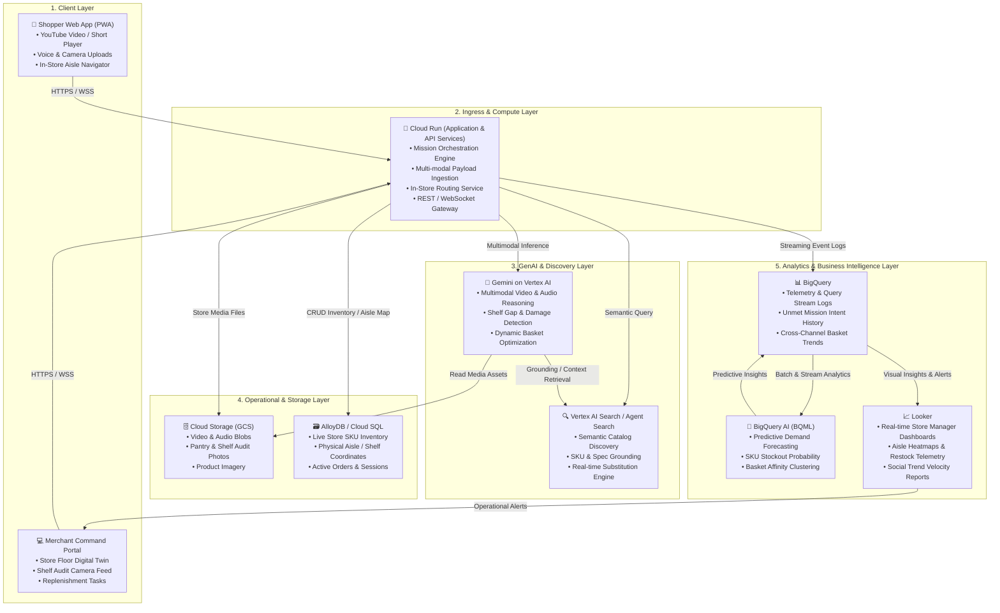

# High-Level Architecture (HLD): OmniMission AI

This document outlines the system architecture and data flow for **OmniMission AI**, built entirely on the **Google Cloud Platform (GCP)**.

---

## 1. System Architecture Diagram

---

## 2. Component Breakdown by Google Cloud Service

| Layer | Google Cloud Technology | Role & Architecture Responsibility |
| :--- | :--- | :--- |
| **Compute & APIs** | **Cloud Run** | • Serverless containerized microservices running the API gateway and agent orchestrator. • Auto-scales to zero; handles low-latency WebSocket connections for live video timestamp syncing and voice processing. |
| **Multimodal Core** | **Gemini on Vertex AI** | • **Video Understanding:** Ingests YouTube video streams and extracts featured products with exact second-level timestamps. • **Voice & Vision:** Parses conversational constraints (budget, guest count) and analyzes user pantry photos. • **Visual Shelf Audit:** Evaluates store shelf photos to detect empty slots, displaced products, and damaged labels. |
| **Discovery & Search** | **Vertex AI Search / Agent Search** | • Semantic vector search over product catalogs and ingredient indexes. • Implements automated RAG (Retrieval-Augmented Generation) with grounding against available inventory. • Finds high-affinity, in-stock substitutions when items are missing. |
| **Asset Storage** | **Cloud Storage (GCS)** | • Secure bucket storage for user-uploaded pantry pictures, camera shelf snapshots, video frames, and product catalog media. • Signed URLs for low-latency client-side asset rendering. |
| **Operational Database** | **AlloyDB / Cloud SQL** | • High-performance relational database managing transactional data: store catalog, live SKU stock counts, physical store floorplan coordinates (Aisle, Bay, Shelf), and shopper carts. |
| **Data Warehouse** | **BigQuery** | • Central data lakehouse ingesting real-time mission telemetry: what shoppers are searching for, what YouTube videos are trending, which substitutions were accepted, and checkout events. |
| **Predictive AI** | **BigQuery AI** | • Executes machine learning models directly in SQL to predict localized inventory depletion. • Identifies unmet demand patterns across geographical clusters before stock runs out. |
| **Business Intelligence** | **Looker** | • Interactive visualization suite for store managers and corporate buyers. • Displays real-time social trend velocity, foot-traffic aisle heatmaps, and restock prioritization queues. |

---

## 3. End-to-End Data Flow

### Flow 1: Shopper Mission Lifecycle (Inspiration ➔ Aisle)
1. **Ingestion:** Shopper sends a YouTube URL, spoken audio prompt, and a pantry photo to **Cloud Run**.
2. **Media Storage:** Assets are stored in **Cloud Storage**, generating reference URIs.
3. **Multimodal Analysis:** **Gemini on Vertex AI** processes the video frames, audio transcript, and pantry photo:
   * Extracts target products with video timestamps.
   * Subtracts items already owned (from pantry image).
   * Identifies constraints (e.g., budget: $50, dietary: gluten-free).
4. **Catalog Grounding & Filtering:** **Vertex AI Search** queries the store's product catalog and matches candidates.
5. **Inventory & Aisle Resolution:** **Cloud Run** queries **AlloyDB / Cloud SQL** for real-time in-store stock and physical aisle coordinates. If an item is out of stock, the substitution agent selects a suitable in-stock alternative.
6. **Delivery to Client:** **Cloud Run** delivers a synchronized shoppable video timeline and an optimized in-store walking path back to the **Shopper PWA**.

### Flow 2: Merchant Telemetry & Shelf Audit Lifecycle
1. **Telemetry Streaming:** Every customer mission and substitution decision is logged asynchronously from **Cloud Run** into **BigQuery**.
2. **Predictive Analytics:** **BigQuery AI** runs scheduled jobs identifying high-velocity items and predicting upcoming stockouts for the local branch.
3. **Operational Alert:** **Looker** highlights an at-risk inventory cluster on the store manager's dashboard.
4. **Visual Audit:** The store manager uploads a photo of the corresponding aisle shelf.
5. **Vision Verification:** **Gemini on Vertex AI** inspects the shelf photo, validates the missing SKU, and generates a restock task in **AlloyDB** for the store inventory team.

---

## 4. Key Architectural Attributes

* **Serverless & Elastic:** Cloud Run and Vertex AI scale dynamically with traffic bursts (e.g., viral social video spikes) without managing server clusters.
* **Low-Latency Retrieval:** Vertex AI Search and AlloyDB ensure catalog lookups and aisle coordinate resolutions return in under 200ms.
* **Strict Grounding:** Gemini utilizes Vertex AI Search grounding and structured function calling to eliminate hallucinations in pricing and SKU stock levels.
* **Enterprise Security:** Identity and Access Management (IAM), Cloud KMS for data encryption at rest and in transit, and private VPC connectors between Cloud Run and databases.
