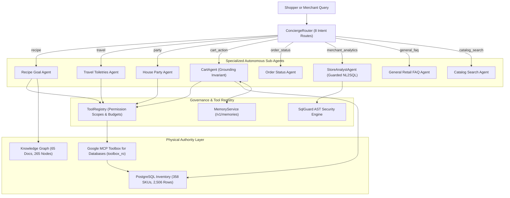

# Multi-Agent Architecture & Specification

## 1. Overview & Framework Verification

OmniMission AI utilizes the **Agno** framework pinned strictly to `agno==3.1.3` (verified via Agno documentation server and recorded in `pyproject.toml`). The system coordinates autonomous, specialized agents powered by Google Gemini models (`gemini-2.0-flash` / `gemini-2.5-flash` for reasoning, text generation, and vision analysis).



---

## 2. Pinned Framework & API Verification

- **Pinned Version:** `agno==3.1.3` (`apps/api/pyproject.toml`).
- **Consulted Documentation Pages:**
  - `https://docs.agno.com/agents/introduction`
  - `https://docs.agno.com/models/google`
  - `https://docs.agno.com/tools/overview`
  - `https://docs.agno.com/workflows/overview`
- **Model Configuration:** Configured via `Settings.gemini_model` and `Settings.gemini_vision_model` environment variables rather than hardcoded strings, supporting `gemini-2.0-flash` and `gemini-2.5-flash`.
- **Agno Model Instantiation Pattern:**
  ```python
  from agno.agent import Agent
  from agno.models.google import Gemini
  from omnimission.core.config import get_settings

  settings = get_settings()
  model = Gemini(id=settings.gemini_model)
  agent = Agent(
      model=model,
      description="OmniMission specialized agent...",
  )
  ```
- **Live vs. Offline Fallback Strategy:**
  Every agent runner checks `settings.google_api_key`. When present, it executes live Google Gemini API calls. If unconfigured or during network latency, deterministic algorithms, hybrid vector search, and AST parsers take over, guaranteeing 100% test reliability and offline execution.

---

## 3. Agent Roster & Detailed Specification

### 3.1 Concierge Router (`ConciergeRouter`)
- **Role:** High-speed intent classification router directing natural-language inputs to the optimal specialized sub-agent.
- **Routes (8 Intent Types):**
  1. `recipe`: Complex culinary objectives (e.g. *"I want to make an eggless strawberry cake for 8"*).
  2. `travel`: Travel kits and airline-compliant packaging (e.g. *"3-day trip to Mumbai toiletries"*).
  3. `party`: Event supplies and guest hosting (e.g. *"House party for 8 guests"*).
  4. `cart_action`: Cart manipulation (e.g. *"Add 2 organic milks to my cart"*).
  5. `order_status`: Order lookup and navigation (e.g. *"Where is my order #104?"*).
  6. `merchant_analytics`: Business operations queries (e.g. *"Which aisles had highest shrinkage?"*).
  7. `general_faq`: Store hours, return policies, and location queries.
  8. `catalog_search`: Direct entity lookup (e.g. *"Do you have almond flour?"*).
- **Fallback Strategy:** Regex keyword matcher and token frequency analyzer.

### 3.2 Cart Agent (`CartAgent`)
- **Role:** Autonomous cart assistant managing item additions, removals, and replacements while strictly enforcing the **Physical Grounding Invariant**.
- **Grounding Invariant:**
  - Every item added to a cart must have a validated `product_id` present in PostgreSQL.
  - The item's price must match the selected store's `StoreInventory.price`.
  - The item must be in-stock (`stock_qty > 0`) in the selected physical store.
  - The agent is strictly prohibited from fabricating products, fake prices, or ghost aisle locations.
- **Tools Used:** `search_catalog`, `get_knowledge_plan`, `add_to_basket`, `remove_from_basket`, `get_cart`.

### 3.3 Personalisation Agent & Memory Store (`PersonalisationAgent`, `MemoryService`)
- **Role:** Captures persistent shopper dietary rules (`vegan`, `eggless`, `gluten_free`), household sizes, and favorite brands.
- **Endpoints:** Full REST API at `/api/v1/memories` for shopper transparency, allowing users to view, add, or delete memories.
- **Enrichment:** Automatically injects memory context into `MissionIntent` to ensure recipes respect remembered constraints without repeated user prompting.

### 3.4 Merchant Store Analyst Agent (`StoreAnalystAgent`)
- **Role:** Conversational operations assistant enabling store managers to query business data via guarded NL2SQL and view interactive Recharts visualizations.
- **Security Engine (`SqlGuard`):**
  - Parses SQL using `sqlglot` (Postgres dialect).
  - Guarantees read-only queries (rejects `INSERT`, `UPDATE`, `DELETE`, `DROP`, `ALTER`, `TRUNCATE`).
  - Enforces strict table allowlist (`v_store_stock_overview`, `v_aisle_traffic`, `v_daily_demand_aggregates`, `v_shrinkage_summary`, `products`, `store_inventory`, `orders`, `order_items`, `restock_tasks`).
  - Mandatory store scoping: automatically injects or validates `store_id = '<authenticated_store>'` in the AST.
  - Enforces statement timeout (`3000ms`) and limit clamping (`LIMIT 100`).
- **Output Formats:** Returns structured JSON containing query answer, sanitized SQL, and chart payload (`chart_type`: `bar` | `line` | `pie` | `table`, `columns`, `data`).

### 3.5 Human-in-the-Loop Action Proposals (`ActionProposalService`)
- **Role:** Generates auditable action proposals for critical operations decisions (restock orders, price adjustments, clearance markdowns).
- **Governance:** Proposals remain in `pending_approval` status until explicitly approved or rejected by an authenticated store manager via `/api/v1/merchant/proposals/{id}/approve` or `reject`.

---

## 4. Governed Tool Registry (`ToolRegistry`)

To prevent arbitrary execution and enforce strict least-privilege security, all tools available to agents are governed by `ToolRegistry`:

| Tool Name | Permission Scope | Side Effect Level | Allowed Principals | Description |
|---|:---:|:---:|:---:|---|
| `search_store_inventory` | `catalog:read` | `read` | Guest, User, Merchant | Search local inventory with proximity & stock filters |
| `get_product_location` | `catalog:read` | `read` | Guest, User, Merchant | Look up exact physical aisle, bay, and shelf coordinates |
| `check_stock_levels` | `catalog:read` | `read` | Guest, User, Merchant | Query real-time inventory quantity and out-of-stock status |
| `get_dietary_substitutes` | `catalog:read` | `read` | Guest, User, Merchant | Find compatible replacement SKUs for dietary requirements |
| `get_knowledge_plan` | `knowledge:read` | `read` | Guest, User, Merchant | Retrieve structured recipe, trip kit, or party guide |
| `add_to_basket` | `cart:write` | `mutating` | Guest, User | Add verified in-stock physical SKU to shopper cart |
| `remove_from_basket` | `cart:write` | `mutating` | Guest, User | Remove or decrement SKU in shopper cart |
| `query_store_analytics` | `merchant:analytics` | `read` | Merchant Only | Execute guarded SQL analytics over merchant store views |

### Agno Tool Export
Each registered tool can be exported as an Agno-compatible `Function` tool using `ToolRegistry.to_agno_tools(principal)`. Tools exceeding the principal's permission scope are omitted, guaranteeing zero scope escalation at runtime.

---

## 5. Google MCP Toolbox for Databases Layer

OmniMission AI implements Google's MCP Toolbox for Databases (`googleapis/mcp-toolbox`) pattern to isolate database access:
1. **Curated Analytical Views:**
   - `v_store_stock_overview`: Inventory status, stock levels, out-of-stock flags.
   - `v_aisle_traffic`: High-traffic physical aisles and pick counts.
   - `v_daily_demand_aggregates`: Daily revenue and volume per store.
   - `v_shrinkage_summary`: Discrepancy audits and shrinkage rates.
2. **Dedicated Role:**
   - Database operations execute under `toolbox_ro`, with permissions restricted strictly to `SELECT` on curated views and catalog tables.
3. **Gateway Adapter (`ToolboxGateway`):**
   - Implements async tool execution adhering to the Google MCP Toolbox tool specification (`infra/toolbox/tools.yaml`).

---

## 6. Empirical Evaluation & Quality Assurances

All agents are continuously benchmarked via `make eval` (see [docs/EVALUATION.md](EVALUATION.md)):
- **Knowledge Retrieval:** Hit Rate @ 5 = 1.00, MRR @ 5 = 0.90, Latency ~65 ms.
- **Physical Grounding Invariant:** 100.0% adherence across 20 shopper missions, 0 hallucinations.
- **SqlGuard AST Security:** 100.0% valid allowed, 100.0% adversarial attacks blocked, 0.0% leaks.
