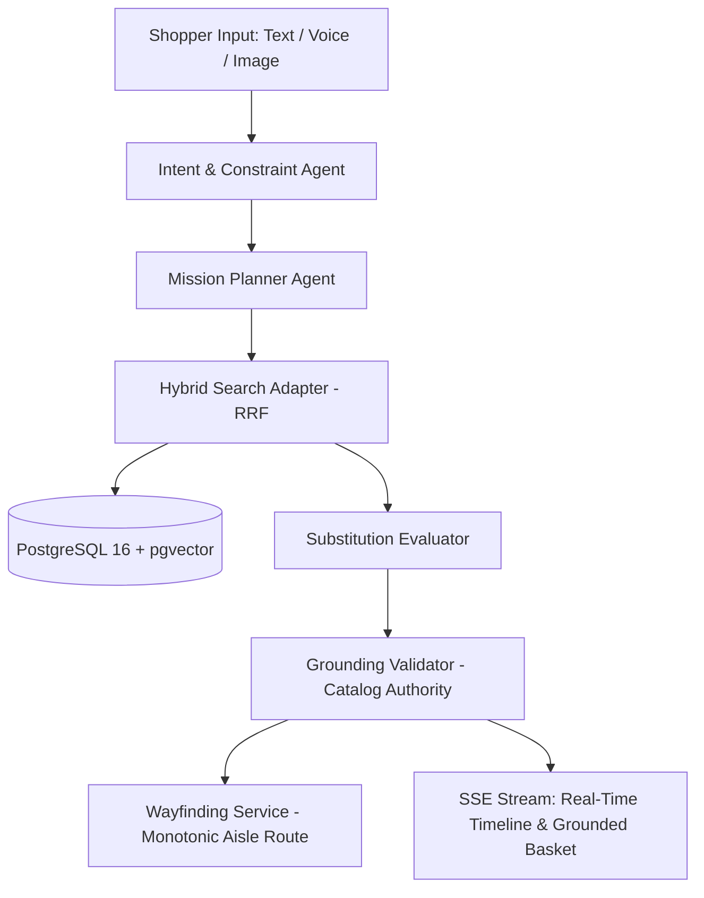

# Multi-Agent Architecture and Specification

## 1. Overview

OmniMission AI orchestrates a multi-agent system built with the **Agno** framework (`agno==3.1.3`) powered by Google **Gemini** models (`gemini-2.0-flash`). The agent graph transforms fuzzy, multimodal shopper inputs into a verified, grounded physical shopping basket with aisle coordinates and wayfinding routes.



---

## 2. Pinned Framework & API Verification

- **Agno Version:** `agno==3.1.3` (pinned in `apps/api/pyproject.toml`).
- **Google Gemini Provider:** `agno.models.google.Gemini`.
- **Structured Outputs Pattern:**
  In Agno 3.1.3, structured outputs are configured using the `output_schema` parameter:
  ```python
  from agno.agent import Agent
  from agno.models.google import Gemini

  agent = Agent(
      model=Gemini(id="gemini-2.0-flash"),
      output_schema=MissionIntent,
      description="You are the Intent & Constraint Decomposition Agent...",
  )
  response = agent.run(prompt)
  # response.content contains the parsed Pydantic model
  ```
- **Live vs. Offline Deterministic Fallback:**
  When `GOOGLE_API_KEY` is present, the agents invoke live Gemini 2.0 Flash models. When unconfigured (e.g., in air-gapped CI environments), agents fall back to deterministic parsing heuristics ensuring 100% test pass rates without external network calls.

---

## 3. Agent Roster

### 3.1 Intent & Constraint Decomposition Agent
- **Role:** Extracts the goal type (`recipe`, `party`, `travel`, `weekly_groceries`, `quick_snack`), headcount, budget limit in INR, dietary restrictions (`vegan`, `vegetarian`, `gluten-free`, `dairy-free`, `sugar-free`), and packaging requirements (`travel_size`).
- **Multilingual Support:** Accepts queries in English, Hindi, Tamil, Kannada, and Telugu, normalizing instructions to English retail catalog taxonomy.
- **Output Schema:** `MissionIntent`.

### 3.2 Mission Planner Agent
- **Role:** Breaks abstract goals into discrete items. For example, *"Eggless cake with good protein"* expands into:
  - Whole wheat / cake flour (1 kg)
  - Plant-based / whey protein powder (500 g)
  - Baking powder & baking soda (100 g)
  - Condensed milk / yogurt egg-substitute (400 g)
  - Dark chocolate chips or cocoa (200 g)
  - Pure vanilla extract (50 ml)
- **Output Schema:** `NeededItemList`.

### 3.3 Substitution Evaluator
- **Role:** When a planned item is out of stock in the user's chosen store, evaluates in-stock alternatives adhering to:
  1. Strict dietary compliance (e.g., never substitute almond milk with dairy milk for a vegan shopper).
  2. Same or adjacent product category.
  3. Comparable brand tier and price range.
  4. Explicit trade-off explanation presented to the shopper.
- **Output Schema:** `SubstitutionProposal`.

### 3.4 Grounding Validator (Catalog Authority)
- **Rule:** LLMs must never hallucinate prices, SKUs, inventory counts, or aisle coordinates.
- **Function:** Inspects all candidate items against verified SQL query hits (`SearchResult` from `PgHybridSearch`). Discards ungrounded or phantom products, and forces unit prices, aisles, bays, and shelves to match the database ground truth.

### 3.5 Wayfinding Service
- **Rule:** Monotonic physical store navigation.
- **Function:** Sorts grounded basket items by Store, Aisle (ascending), Bay (ascending), and Shelf (ascending). Consolidates items on the same shelf into single stops with intuitive picking instructions.

---

## 4. Real-Time Streaming & Tracing

- Every execution step emits an SSE `TimelineEvent`:
  - `parsing_intent` (In progress)
  - `intent_parsed` (Completed)
  - `planning_items` (In progress)
  - `items_planned` (Completed)
  - `searching_catalog` (In progress)
  - `catalog_searched` (Completed)
  - `optimizing_basket` (In progress)
  - `complete` (Final grounded basket + monotonic route)
- Step metrics, latency, inputs, and outputs are persisted to the `mission_runs` PostgreSQL table for full auditability and merchant telemetry.
