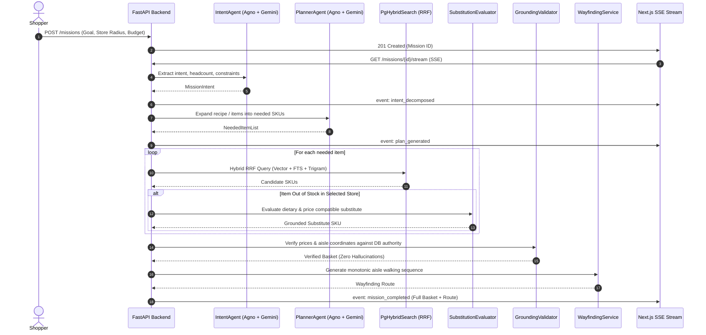
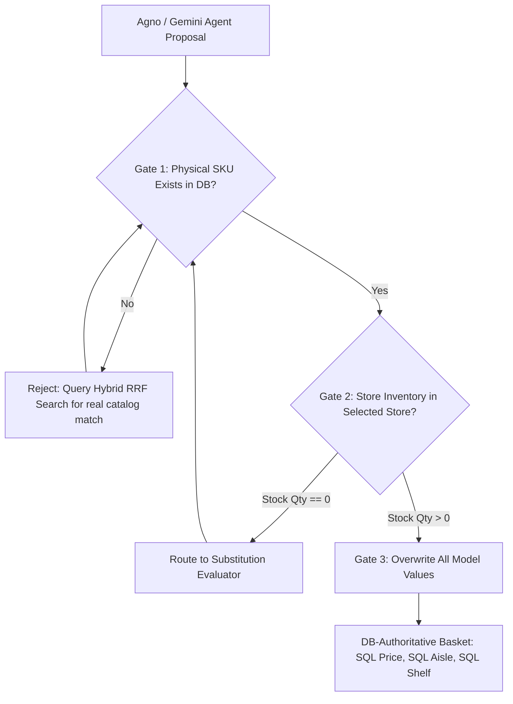

# Multi-Agent Architecture & Specification

## 1. Overview & Framework Verification

OmniMission AI utilizes the **Agno** framework pinned strictly to `agno==3.1.3` (verified via Agno documentation server). The system coordinates autonomous agents powered by Google Gemini models (`gemini-2.0-flash` for text/reasoning and `gemini-2.5-flash` for multimodal vision).



---

## 2. Pinned Framework & API Verification

- **Pinned Version:** `agno==3.1.3` (`pyproject.toml`).
- **Model Classes:** `agno.models.google.Gemini`.
- **Structured Outputs Pattern:**
  Configured with `output_schema` parameter conforming to Agno 3.1.3 specifications:
  ```python
  from agno.agent import Agent
  from agno.models.google import Gemini
  from omnimission.agents.schemas import MissionIntent

  agent = Agent(
      model=Gemini(id="gemini-2.0-flash"),
      output_schema=MissionIntent,
      description="Extract intent, headcount, dietary tags, and budget...",
  )
  response = agent.run(user_prompt)
  parsed: MissionIntent = response.content
  ```
- **Live vs. Offline Fallback Strategy:**
  Every agent runner checks `settings.google_api_key`. When present, it executes live Google Gemini API calls. If unconfigured (or during network timeout), deterministic parsing algorithms and heuristics take over, guaranteeing 100% test reliability and air-gapped demo execution.

---

## 3. Agent Roster & Detailed Specification

### 3.1 Intent & Constraint Decomposition Agent (`IntentAgentRunner`)
- **Role:** Analyzes raw natural language (or transcribed audio) and extracts structured parameters.
- **Model:** `gemini-2.0-flash` (temperature: 0.1).
- **Instructions:** Identifies goal category (`recipe`, `party`, `travel`, `weekly_groceries`, `quick_snack`), headcount (defaults: recipe=4, party=8), budget limit in INR, dietary restrictions (`vegan`, `vegetarian`, `gluten_free`, `high_protein`, `eggless`, `dairy_free`), and packaging constraints (`is_travel_size`).
- **Multilingual Capability:** Accepts inputs in English, Hindi, Tamil, Kannada, and Marathi, normalizing retail taxonomy into English catalog tags.
- **Input Schema:** Natural language string prompt.
- **Output Schema:** `MissionIntent` (Pydantic v2).
- **Fallback Strategy:** Regex and keyword matching (`regex_budget`, `regex_headcount`, dietary token matching).

### 3.2 Mission Planner Agent (`PlannerAgentRunner`)
- **Role:** Expands high-level objectives into concrete retail ingredient and item lists.
- **Model:** `gemini-2.0-flash` (temperature: 0.2).
- **Instructions:** Decomposes culinary goals (e.g., *"Eggless chocolate cake with good protein"*) into essential components (flour, protein powder, leaveners, egg substitutes, chocolate/flavoring) while observing dietary restrictions.
- **Input Schema:** `MissionIntent` + user goal string.
- **Output Schema:** `NeededItemList` containing list of `NeededItemSpec`.
- **Fallback Strategy:** Domain-curated recipe decomposition knowledge base for party, travel, baking, and fitness groceries.

### 3.3 Substitution Evaluator (`SubstitutionEvaluator`)
- **Role:** Identifies and justifies valid substitutes when an item is out of stock in the user's primary store.
- **Model:** Heuristic-grounded evaluation engine with optional Gemini explanation.
- **Rules & Invariants:**
  1. **Strict Dietary Compatibility:** A vegan request will NEVER be substituted with dairy milk or whey protein.
  2. **Size Category Compatibility:** A travel-size request (compliant with airline rules ≤100ml) will NEVER be substituted with full-size bottles.
  3. **Price Bounds:** Substitute unit price must not exceed 130% of the original item's target price.
- **Output Schema:** `SubstitutionEvaluation` (`candidate_id`, `reason`, `confidence_score`).

### 3.4 Grounding Validator (`GroundingValidator`)
- **Role:** Enforces 100% database authority.
- **Authority Guarantee:** The AI model is strictly prohibited from inventing prices, stock counts, or aisle locations.
- **Flow:** Every item in the final basket MUST match an existing `StoreInventory` record in the database. Prices, MRP, stock counts, and `(aisle, bay, shelf)` locations are loaded directly from SQL columns.

### 3.5 Multimodal Vision Agent (`VisionAgentRunner`)
- **Role:** Takes uploaded user photographs (pantry items, labels, product packaging) and generates search queries for catalog grounding.
- **Model:** `gemini-2.5-flash` (multimodal vision).
- **Input:** Image bytes (`image/jpeg`, `image/png`) + optional user hint.
- **Output Schema:** `VisionAnalysisResult` (`primary_query`, `detected_items`, `suggested_action`).

### 3.6 Autonomous Shelf Audit Agent (`ShelfAuditAgentRunner`)
- **Role:** Evaluates physical store aisle photos against expected database inventory.
- **Model:** `gemini-2.5-flash` with in-context store aisle grounding.
- **Workflow:**
  1. Queries all expected SKUs in the designated store and aisle.
  2. Sends the photo with expected product names and bay/shelf positions to Gemini Vision.
  3. Detects empty shelf spaces, missing facings, and stock gaps.
  4. Auto-drafts replenishment `RestockTask` records in the database.
- **Output Schema:** `ShelfAuditResult` (`total_gaps_detected`, `findings`, `summary`).

---

## 4. The Formal Grounding Guarantee

Large Language Models frequently hallucinate prices, out-of-stock items, or fictional shelf locations. OmniMission AI eliminates hallucinations through a **three-gate architectural air gap**:



### Invariant Rules
1. **Price Authority:** Basket item price is ALWAYS `Decimal(StoreInventory.price)`. The LLM's price estimate is completely ignored.
2. **Spatial Authority:** Basket item location is ALWAYS `(StoreInventory.aisle, StoreInventory.bay, StoreInventory.shelf)`.
3. **Availability Authority:** An item is only marked in-stock if `StoreInventory.stock_qty > 0`.
