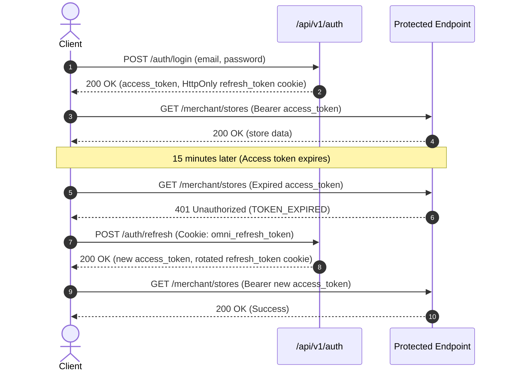

# OmniMission AI: REST & Streaming API Specification

## 1. Design Philosophy

OmniMission AI's HTTP API follows strict RESTful conventions, OpenAPI 3.1 specifications, and cloud-native resilience standards:
1. **RFC 7807 Problem Details:** All error responses return structured `application/problem+json` bodies containing:
   ```json
   {
     "type": "about:blank",
     "title": "Bad Request",
     "status": 400,
     "detail": "Password must be at least 8 characters long and contain numbers",
     "code": "INVALID_PASSWORD",
     "instance": "/api/v1/auth/register",
     "errors": []
   }
   ```
2. **Server-Sent Events (SSE):** Long-running agent reasoning and multi-step decomposition stream through `text/event-stream` endpoints (`GET /api/v1/missions/{id}/stream`), delivering live timeline events to the client.
3. **Strict RBAC & Token Family Security:** All non-public endpoints enforce bearer authentication with role authorization (`user` or `merchant`).

---

## 2. Authentication Flow



---

## 3. Complete Endpoint Reference

### Authentication (`/api/v1/auth`)
| Method | Path | Role | Description |
| :--- | :--- | :--- | :--- |
| `POST` | `/api/v1/auth/register` | Public | Create new shopper or merchant account |
| `POST` | `/api/v1/auth/login` | Public | Authenticate credentials; sets refresh cookie |
| `POST` | `/api/v1/auth/refresh` | Public | Rotate refresh token family; returns fresh access token |
| `POST` | `/api/v1/auth/logout` | Authenticated | Revoke refresh token family; clears session cookies |
| `GET` | `/api/v1/auth/me` | Authenticated | Retrieve current user profile |

### Stores & Catalog (`/api/v1/stores` & `/api/v1/catalog`)
| Method | Path | Role | Description |
| :--- | :--- | :--- | :--- |
| `GET` | `/api/v1/stores` | Public | List stores with optional city filter |
| `GET` | `/api/v1/stores/nearby` | Public | Proximity store search via Haversine spherical distance (`lat`, `lng`, `radius_km`) |
| `GET` | `/api/v1/stores/{id}` | Public | Store details, operating hours, and location |
| `GET` | `/api/v1/catalog/search` | Public | Hybrid RRF search (`q`, `store_id`, `dietary_tags`, `category`) |

### Missions & Wayfinding (`/api/v1/missions`)
| Method | Path | Role | Description |
| :--- | :--- | :--- | :--- |
| `POST` | `/api/v1/missions` | Shopper (`user`)| Ingest goal, trigger Agno multi-agent workflow |
| `GET` | `/api/v1/missions/{id}` | Shopper | Retrieve mission basket, items, and wayfinding route |
| `GET` | `/api/v1/missions/{id}/stream` | Shopper | Real-time SSE timeline event stream |
| `PATCH`| `/api/v1/missions/{id}/items/{item_id}` | Shopper | Adjust item quantity or toggle picked status |
| `GET` | `/api/v1/missions` | Shopper | Paginated mission history for current user |

### Multimodal Uploads & Voice (`/api/v1/uploads`, `/api/v1/voice`, `/api/v1/vision`)
| Method | Path | Role | Description |
| :--- | :--- | :--- | :--- |
| `POST` | `/api/v1/uploads` | Authenticated | Multipart upload with magic-byte verification (JPEG, PNG, WebM) |
| `POST` | `/api/v1/voice/transcribe`| Authenticated | Gemini voice audio transcription with language hints |
| `POST` | `/api/v1/vision/analyze` | Authenticated | Gemini Vision extraction of catalog search queries from images |

### Merchant Operations (`/api/v1/merchant`)
| Method | Path | Role | Description |
| :--- | :--- | :--- | :--- |
| `GET` | `/api/v1/merchant/stores` | Merchant (`merchant`)| List owned physical retail branches |
| `GET` | `/api/v1/merchant/inventory` | Merchant | List inventory with stock counts and shelf coordinates |
| `PATCH`| `/api/v1/merchant/inventory/{id}` | Merchant | Update SKU stock quantity, price, or shelf location |
| `POST` | `/api/v1/merchant/inventory/import` | Merchant | Multipart CSV batch upload with validation report |
| `GET` | `/api/v1/merchant/analytics/overview` | Merchant | Store overview KPIs (missions, grounded GMV, at-risk SKUs) |
| `GET` | `/api/v1/merchant/analytics/demand` | Merchant | Real-time demand radar and out-of-stock query signals |
| `POST` | `/api/v1/merchant/shelf-audit` | Merchant | Run AI shelf audit on photo and auto-draft restock tasks |
| `GET` | `/api/v1/merchant/restock-tasks` | Merchant | List store replenishment restock tasks |
| `PATCH`| `/api/v1/merchant/restock-tasks/{id}` | Merchant | Update restock task status (`approved`, `completed`, `dismissed`) |

---

## 4. cURL Golden Demo Playbook

### Demo 1: High-Protein Eggless Cake
```bash
curl -X POST http://localhost:8000/api/v1/missions \
  -H "Authorization: Bearer $SHOPPER_TOKEN" \
  -H "Content-Type: application/json" \
  -d '{
    "raw_input": "Eggless cake with good protein, suggest all ingredients",
    "store_ids": ["a3b8d1c0-7f2e-4e6a-9d3c-1b8e4f5a6b7c"],
    "budget_limit": 1500.0,
    "dietary_tags": ["eggless", "high_protein"]
  }'
```

### Demo 2: Travel-Size Toiletries for 3 Days
```bash
curl -X POST http://localhost:8000/api/v1/missions \
  -H "Authorization: Bearer $SHOPPER_TOKEN" \
  -H "Content-Type: application/json" \
  -d '{
    "raw_input": "I am travelling to Mumbai for 3 days, I need travel-size shampoo, toothpaste, etc.",
    "store_ids": ["a3b8d1c0-7f2e-4e6a-9d3c-1b8e4f5a6b7c"],
    "budget_limit": 600.0
  }'
```

### Demo 3: Multilingual Voice Audio Query (Hindi)
```bash
curl -X POST http://localhost:8000/api/v1/voice/transcribe \
  -H "Authorization: Bearer $SHOPPER_TOKEN" \
  -F "file=@query_hindi.webm;type=audio/webm" \
  -F "hint_language=hi"
```

### Demo 4: House Party for 8 Guests
```bash
curl -X POST http://localhost:8000/api/v1/missions \
  -H "Authorization: Bearer $SHOPPER_TOKEN" \
  -H "Content-Type: application/json" \
  -d '{
    "raw_input": "I want to host a party for 8 people, chips drinks cups napkins",
    "store_ids": ["a3b8d1c0-7f2e-4e6a-9d3c-1b8e4f5a6b7c"],
    "budget_limit": 1200.0
  }'
```

### Demo 5: Merchant Shelf Audit & Replenishment
```bash
# 1. Run visual shelf audit
curl -X POST http://localhost:8000/api/v1/merchant/shelf-audit \
  -H "Authorization: Bearer $MERCHANT_TOKEN" \
  -H "Content-Type: application/json" \
  -d '{
    "store_id": "a3b8d1c0-7f2e-4e6a-9d3c-1b8e4f5a6b7c",
    "file_url": "/static/uploads/shelf_facing_aisle3.jpg",
    "aisle": 3
  }'

# 2. Mark replenishment task completed (auto-increments inventory stock)
curl -X PATCH http://localhost:8000/api/v1/merchant/restock-tasks/$TASK_ID \
  -H "Authorization: Bearer $MERCHANT_TOKEN" \
  -H "Content-Type: application/json" \
  -d '{"status": "completed"}'
```
