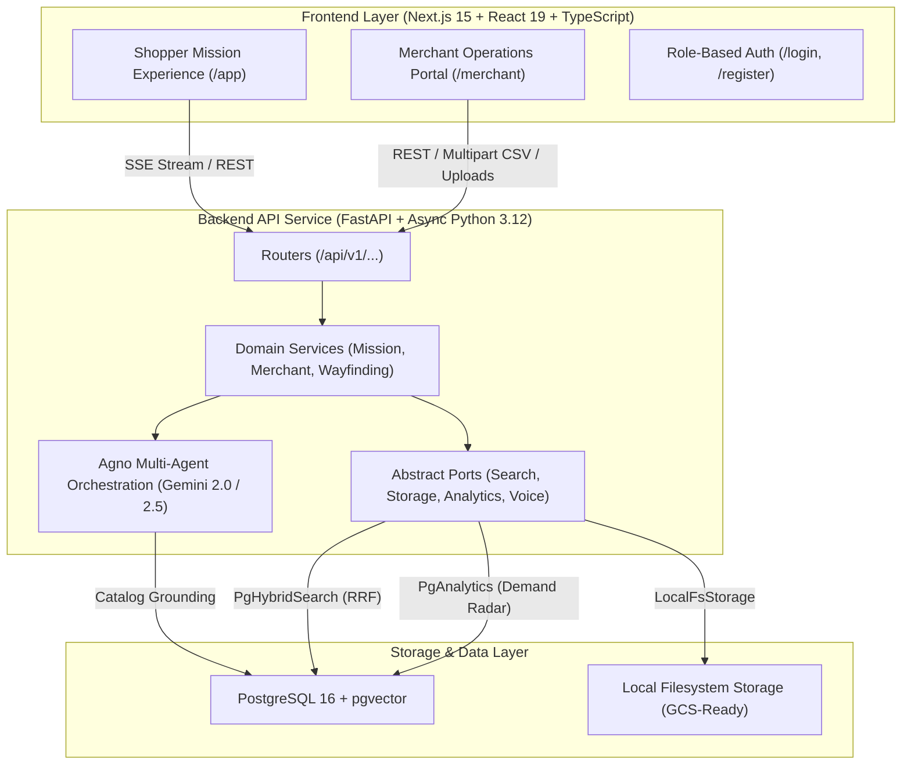

# OmniMission AI: System Architecture

## 1. System Overview

**OmniMission AI** is a dual-sided "phygital" commerce platform that bridges conversational digital intent with physical in-store retail execution.
- **Shoppers** complete goal-driven missions (via natural language, multi-lingual voice, or product photographs), which are decomposed by autonomous AI agents, grounded strictly in the real physical inventory of nearby stores, resolved to physical aisle/bay/shelf coordinates, and navigated with a monotonic walking path.
- **Merchants** monitor real-time neighborhood demand signals, track stockout substitution risks, execute multimodal shelf audits via Gemini Vision, and manage restocking tasks that atomically reconcile in-store stock levels upon completion.



---

## 2. Layered Backend Architecture

OmniMission AI enforces strict architectural separation of concerns. No business logic leaks into routers, and database ORM sessions never leak upward into presentation layers:

$$\text{Router} \longrightarrow \text{Service} \longrightarrow \text{Repository / Port} \longrightarrow \text{Database}$$

1. **Router Layer (`src/omnimission/api/v1/`):**
   - Pure HTTP ingress points.
   - Responsible for schema validation (Pydantic v2), dependency injection (`Depends`), security role assertions (`require_shopper`, `require_merchant`), and mapping exceptions to RFC 7807 Problem Details.
   - Zero SQL queries or direct agent executions.
2. **Service Layer (`src/omnimission/services/`):**
   - Encapsulates business logic, transactional boundaries, store ownership validations, and orchestration.
   - Never imports FastAPI or HTTP constructs.
   - Services invoke agents via typed runner classes and interact with storage/search backends through narrow protocol ports.
3. **Agent Layer (`src/omnimission/agents/`):**
   - Agno (`agno==3.1.3`) agent definitions and workflow graph.
   - Decoupled into `IntentAgentRunner`, `PlannerAgentRunner`, `SubstitutionEvaluator`, `GroundingValidator`, and `ShelfAuditAgentRunner`.
   - 100% resilient: calls Google Gemini when `GOOGLE_API_KEY` is present, with deterministic offline heuristics for zero-network environments.
4. **Ports & Adapters Layer (`src/omnimission/ports/` & `src/omnimission/adapters/`):**
   - Clean Hexagonal Architecture (Ports and Adapters). All platform integrations implement abstract typing protocols.
   - Phase 1 local implementations can be swapped for GCP services in Phase 2 with zero changes to service logic.
5. **Database Models & Alembic (`src/omnimission/models/` & `migrations/`):**
   - Declarative SQLAlchemy 2.0 async models with strict foreign keys, UUID primary keys, and timestamp mixins.
   - PostgreSQL 16 schema managed via Alembic migrations.

---

## 3. Ports and Adapters (Hexagonal Architecture)

To ensure OmniMission AI is **100% GCP-Ready**, every infrastructure dependency is abstracted behind a typed Python `Protocol`:

| Port Protocol | Phase 1 Local Adapter | Phase 2 GCP Target Adapter | Purpose |
| :--- | :--- | :--- | :--- |
| `SearchBackend` | `PgHybridSearch` (pgvector + FTS + Trigram with RRF) | `VertexAiSearchAdapter` | Hybrid semantic vector + lexical catalog retrieval |
| `StorageBackend` | `LocalFsStorage` (magic-byte validation, 10MB limit) | `GoogleCloudStorageAdapter` (Cloud Storage Bucket) | Multi-modal uploads (shelf images, voice audio blobs) |
| `AnalyticsSink` | `PgAnalytics` (indexed PostgreSQL aggregation) | `BigQueryAnalyticsSink` (BigQuery + Looker) | Real-time demand telemetry, GMV metrics, unmet signals |
| `TranscriptionProvider`| `GeminiTranscriptionProvider` | `GoogleCloudSpeechToTextAdapter` / Gemini Audio | Multilingual voice query transcription |
| `EmbeddingProvider` | `SentenceTransformer` / Hash Embeddings | `VertexAiTextEmbeddingAdapter` (`text-embedding-005`) | Catalog description dense vector generation |

---

## 4. Multi-Agent Orchestration & Real-Time SSE Transport

### Agno Workflow Orchestration
Mission decomposition is coordinated as an end-to-end multi-agent pipeline (`MissionWorkflow`) that guarantees physical catalog grounding before delivering results:
1. **Multimodal Ingestion:** Ingests raw shopper text, audio (transcribed by Gemini), or photos (analyzed by Gemini Vision).
2. **Intent & Constraint Agent:** Extracts intent type, headcount, budget ceiling, dietary restrictions, and packaging tags.
3. **Planner Agent:** Expands fuzzy goals into concrete retail categories and needed ingredient lists.
4. **Hybrid RRF Search:** Retrieves top candidate products from physical inventory within the user's selected store radius.
5. **Substitution Evaluator:** Resolves out-of-stock items using strict dietary and size compatibility heuristics.
6. **Grounding Validator:** Strips all agent hallucinations by verifying price and aisle coordinates against real database records.
7. **Wayfinding Service:** Calculates a monotonic aisle walking route ($Aisle_1 \to Aisle_2 \to \dots \to Aisle_N$) with bay and shelf coordinates.

### Server-Sent Events (SSE) Streaming
Rather than blocking for 5-10 seconds, `GET /api/v1/missions/{id}/stream` streams structured JSON `TimelineEvent`s in real time:
```text
event: intent_decomposed
data: {"step": "intent_decomposed", "agent": "IntentAgent", "status": "completed", "latency_ms": 320, "data": {...}}

event: plan_generated
data: {"step": "plan_generated", "agent": "PlannerAgent", "status": "completed", "latency_ms": 480, "data": {...}}

event: catalog_grounded
data: {"step": "catalog_grounded", "agent": "GroundingValidator", "status": "completed", "latency_ms": 210, "data": {...}}

event: mission_completed
data: {"step": "mission_completed", "agent": "MissionWorkflow", "status": "completed", "latency_ms": 1150, "data": {...}}
```
The client hook (`useMissionStream`) animates progress cards in real-time, giving shoppers complete transparency into multi-agent decision making.

---

## 5. Security & Authentication Model

1. **Password Hashing:**
   - Password hashes use **Argon2id** (`argon2-cffi`), the winner of the Password Hashing Competition, configured with high memory and iteration parameters resistant to GPU attacks.
2. **Stateless JWT + Refresh Token Rotation Family:**
   - Short-lived Access Tokens (15-minute expiration) signed with `HS256`.
   - Long-lived Refresh Tokens (14-day expiration) stored in `HttpOnly`, `SameSite=Lax` cookies.
   - **Reuse Detection with Family Invalidation:** Each refresh token belongs to a cryptographically unique `family_id`. If a revoked or already-exchanged refresh token is presented, the entire token family is immediately revoked, protecting against token theft.
3. **Role-Based Access Control (RBAC):**
   - Strict roles: `user` (Shopper) and `merchant` (Store Operator).
   - Backend routes enforce roles via FastAPI dependencies (`require_shopper`, `require_merchant`).
   - Next.js middleware guards routes (`/app` vs `/merchant`), redirecting unauthorized roles to their respective domains.
4. **Input Sanitization & Storage Guardrails:**
   - File uploads inspect binary **magic bytes** (`image/jpeg`, `image/png`, `audio/webm`) rather than trusting file extensions or client-provided MIME headers.
   - Hard 10MB limit with atomic file validation prevents disk flooding and remote execution payloads.
