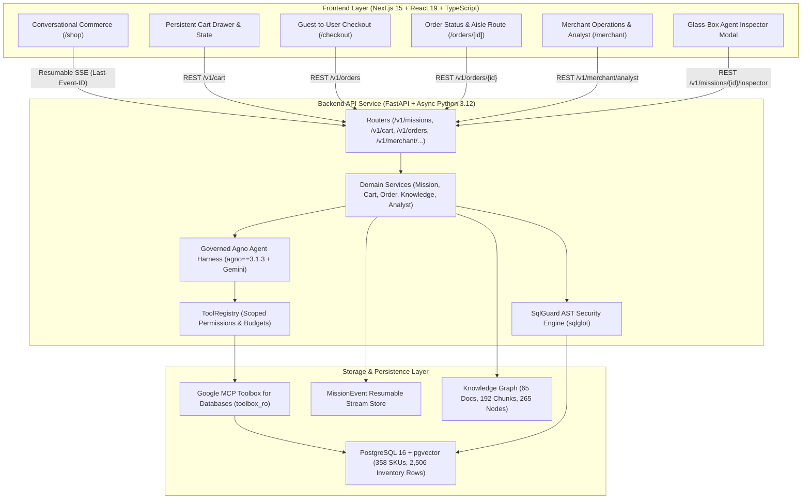
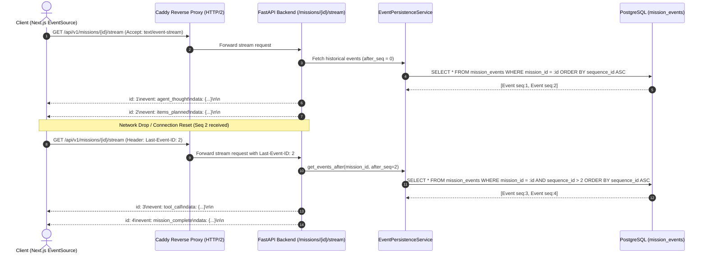
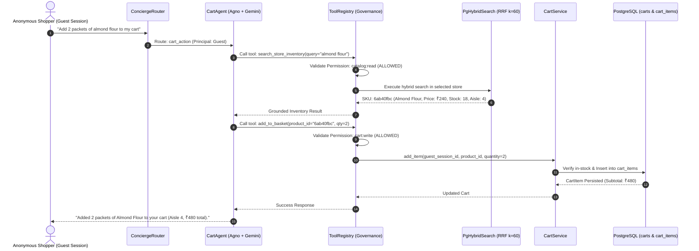
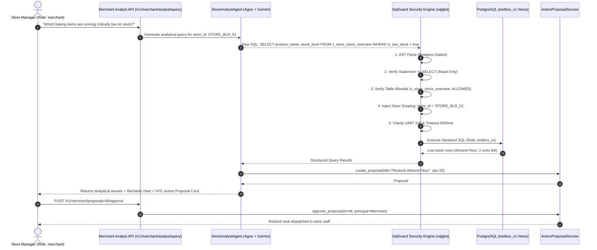
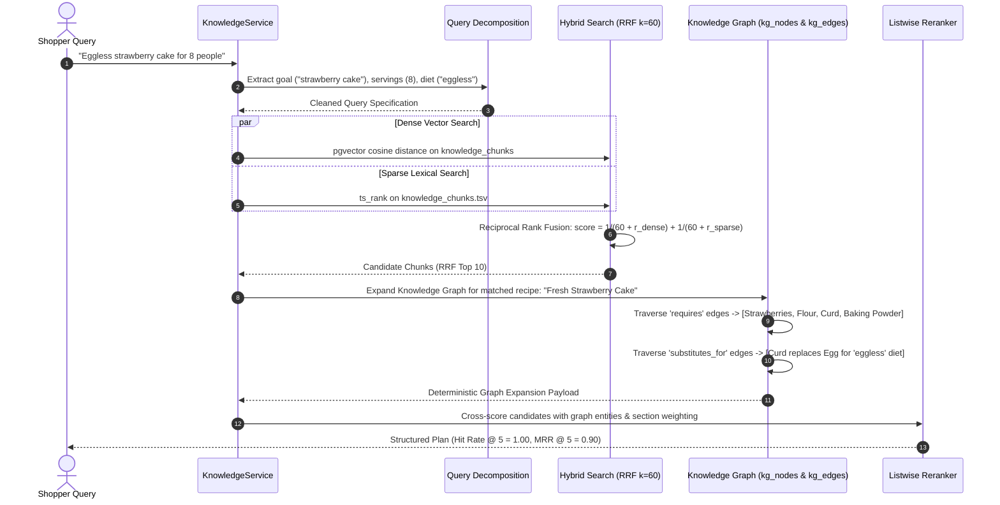

# OmniMission AI: System Architecture

## 1. System Overview

**OmniMission AI** is a dual-sided "phygital" commerce platform that bridges conversational digital intent with physical in-store retail execution.
- **Shoppers** complete goal-driven missions (via natural language, multi-lingual voice, or product photographs), which are decomposed by autonomous AI agents, grounded strictly in the real physical inventory of nearby stores, resolved to physical aisle/bay/shelf coordinates, added to persistent carts, and navigated with a monotonic walking path.
- **Merchants** monitor real-time neighborhood demand signals, query their store performance using guarded natural-language-to-SQL (NL2SQL), review automated daily briefings, execute multimodal shelf audits via Gemini Vision, and approve Human-in-the-Loop (HITL) restocking action proposals.

---

## 2. Layered Backend Architecture

OmniMission AI enforces strict architectural separation of concerns. Presentation layers never perform database queries, and database ORM sessions never leak upward:

$$\text{Router Layer} \longrightarrow \text{Domain Service Layer} \longrightarrow \text{Repository / Ports} \longrightarrow \text{Database Layer}$$

1. **Router Layer (`src/omnimission/api/v1/`):**
   - Pure HTTP ingress points validating schemas (Pydantic v2), extracting unified `Principal` tokens (`get_current_principal`), asserting role permissions (`require_merchant`), and mapping exceptions to RFC 7807 Problem Details.
2. **Domain Service Layer (`src/omnimission/services/`):**
   - Encapsulates core business logic: `MissionService`, `CartService`, `OrderService`, `KnowledgeService`, `StoreAnalystService`, `ActionProposalService`, and `EventPersistenceService`.
   - Never imports FastAPI or presentation constructs.
3. **Agent & Governance Layer (`src/omnimission/agents/`):**
   - Agno (`agno==3.1.3`) agent orchestration: `ConciergeRouter`, `CartAgent`, `PersonalisationAgent`, `StoreAnalystAgent`, `MissionWorkflow`.
   - `ToolRegistry` enforces fine-grained permission scopes (`catalog:read`, `cart:write`, `store:read`, `merchant:analytics`, `knowledge:read`) and token budgets.
4. **Ports & Adapters Layer (`src/omnimission/ports/` & `src/omnimission/adapters/`):**
   - Hexagonal Architecture (Ports and Adapters) isolating cloud-shaped dependencies. Local implementations swap into Google Cloud services with zero service-layer code modifications.
5. **Database Models & Alembic (`src/omnimission/models/` & `migrations/`):**
   - Declarative SQLAlchemy 2.0 async models with strict UUID primary keys and foreign key constraints across 10 Alembic migrations.

---

## 3. Core Protocol Sequence Diagrams

### 3.1 Resumable SSE Protocol over HTTP/2

Guarantees zero lost or duplicated events across intermittent network disconnections using monotonic sequence IDs and the standard `Last-Event-ID` header.

---

### 3.2 Governed Cart Agent & Grounding Invariant

Guarantees that every item placed in a cart is grounded in verified, in-stock physical inventory.

---

### 3.3 Merchant Store Analyst & Guarded NL2SQL

Guarantees 100% defense against SQL injection, data exfiltration, and cross-store leakage, with HITL approvals for consequential store operations.

---

### 3.4 Advanced RAG v2: Hybrid RRF & Recursive Knowledge Graph Expansion

Combines dense semantic vector retrieval with lexical keyword search and recursive Knowledge Graph traversal to guarantee complete ingredient and substitution recall.

---

## 4. Hexagonal Architecture (Ports and Adapters)

To guarantee that OmniMission AI is **100% GCP-Ready**, every infrastructure concern is decoupled behind typed Python `Protocol` interfaces:

| Port Protocol | Local Adapter | GCP Target Adapter | Purpose |
| :--- | :--- | :--- | :--- |
| `SearchBackend` | `PgHybridSearch` (pgvector + FTS + RRF) | `VertexAiSearchAdapter` | Hybrid semantic vector + lexical catalog retrieval |
| `StorageBackend` | `LocalFsStorage` (magic-byte validation) | `GoogleCloudStorageAdapter` (Cloud Storage Bucket) | Multi-modal uploads (shelf images, voice audio blobs) |
| `AnalyticsSink` | `PgAnalytics` (indexed PostgreSQL aggregation) | `BigQueryAnalyticsSink` (BigQuery + Looker) | Real-time demand telemetry, GMV metrics, unmet signals |
| `TranscriptionProvider`| `GeminiTranscriptionProvider` | `GoogleCloudSpeechToTextAdapter` / Gemini Audio | Multilingual voice query transcription |
| `EmbeddingProvider` | `SentenceTransformer` / Hash Embeddings | `VertexAiTextEmbeddingAdapter` (`text-embedding-005`) | Catalog description dense vector generation |
| `DatabaseToolProvider` | `ToolboxGateway` (Local Postgres Views) | `GoogleMcpToolboxAdapter` (AlloyDB / Cloud SQL) | Parameterised, read-only database tools |
