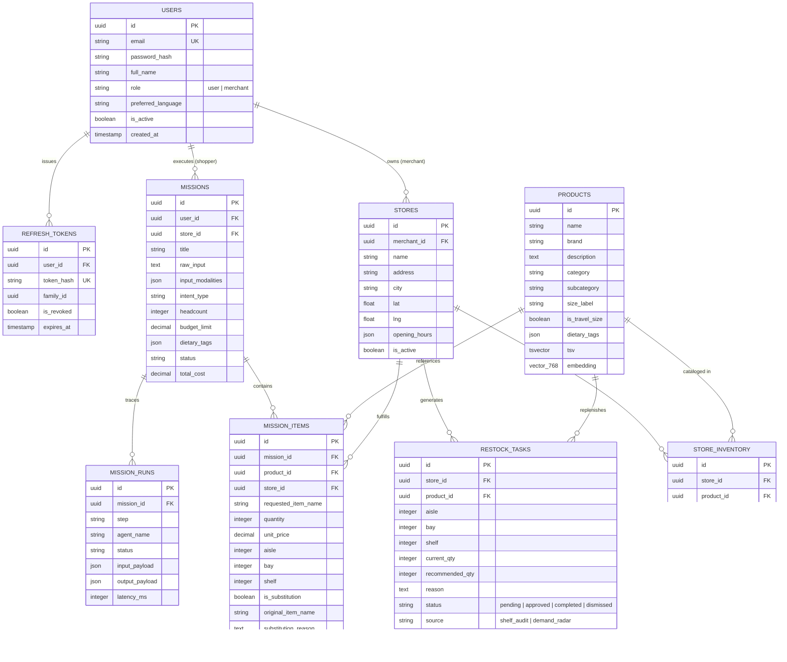

# OmniMission AI: Data Model & Schema Specification

## 1. Entity-Relationship Diagram



---

## 2. Table Specifications

### `users`
- **Purpose:** Stores authenticated user identities and role definitions (`user` for shoppers, `merchant` for store operators).
- **Primary Key:** `id` (`UUID`, defaults to `uuid_generate_v4()`).
- **Columns:**
  - `email`: `VARCHAR(255)`, unique, indexed.
  - `password_hash`: `VARCHAR(255)`, Argon2id encoded hash.
  - `full_name`: `VARCHAR(255)`.
  - `role`: `VARCHAR(50)`, default `'user'`.
  - `preferred_language`: `VARCHAR(10)`, default `'en'` (`'hi'`, `'ta'`, `'te'`, etc.).
  - `is_active`: `BOOLEAN`, default `TRUE`.
  - `created_at`, `updated_at`: `TIMESTAMPTZ`.

### `refresh_tokens`
- **Purpose:** Tracks refresh tokens for single-flight rotation and family reuse revocation.
- **Columns:**
  - `user_id`: `UUID`, foreign key to `users.id` with `ON DELETE CASCADE`.
  - `token_hash`: `VARCHAR(64)`, SHA-256 hash of token secret, unique index.
  - `family_id`: `UUID`, cryptographic family identifier.
  - `is_revoked`: `BOOLEAN`, default `FALSE`.
  - `expires_at`: `TIMESTAMPTZ`.

### `stores`
- **Purpose:** Physical retail store branches with coordinates and merchant ownership.
- **Columns:**
  - `merchant_id`: `UUID`, foreign key to `users.id`.
  - `name`: `VARCHAR(255)`, indexed.
  - `address`: `TEXT`.
  - `city`: `VARCHAR(100)`, indexed (`Bengaluru`, `Mumbai`, `Delhi`, `Hyderabad`).
  - `lat`, `lng`: `DOUBLE PRECISION`, indexed for Haversine proximity calculations.
  - `opening_hours`: `JSONB`.
  - `is_active`: `BOOLEAN`, default `TRUE`.

### `products`
- **Purpose:** Master physical retail catalog items with rich dietary tags and search vectors.
- **Columns:**
  - `name`, `brand`: `VARCHAR(255)`, indexed.
  - `description`: `TEXT`.
  - `category`, `subcategory`: `VARCHAR(100)`, indexed.
  - `size_label`: `VARCHAR(50)` (e.g., `'500 g'`, `'50 ml'`).
  - `is_travel_size`: `BOOLEAN`, indexed (flag for airline liquid compliance ≤100ml).
  - `dietary_tags`: `JSONB`, GIN indexed (`vegetarian`, `vegan`, `gluten_free`, `high_protein`, `eggless`).
  - `tsv`: `TSVECTOR`, GIN indexed for English full-text search.
  - `embedding`: `VECTOR(768)`, pgvector cosine distance indexed.

### `store_inventory`
- **Purpose:** Real-time stock levels, pricing authority, and shelf coordinates for each store.
- **Columns:**
  - `store_id`: `UUID`, foreign key to `stores.id`.
  - `product_id`: `UUID`, foreign key to `products.id`.
  - `sku`: `VARCHAR(100)`, unique per store, indexed.
  - `price`, `mrp`: `NUMERIC(10, 2)`.
  - `stock_qty`: `INTEGER`, default `0`.
  - `low_stock_threshold`: `INTEGER`, default `5`.
  - `aisle`, `bay`, `shelf`: `INTEGER`, physical store location markers.

### `missions`
- **Purpose:** Goal-driven shopper sessions tracking multimodal inputs and agent state.
- **Columns:**
  - `user_id`: `UUID`, foreign key to `users.id`.
  - `store_id`: `UUID`, primary fulfilling store.
  - `title`, `raw_input`: `TEXT`.
  - `input_modalities`: `JSONB` (`['text']`, `['voice']`, `['image']`).
  - `intent_type`: `VARCHAR(50)` (`recipe`, `party`, `travel`, `weekly_groceries`).
  - `headcount`: `INTEGER`, default `4`.
  - `budget_limit`: `NUMERIC(10, 2)`.
  - `status`: `VARCHAR(50)` (`analyzing`, `planning`, `grounded`, `completed`, `failed`).
  - `total_cost`: `NUMERIC(10, 2)`.

### `mission_items`
- **Purpose:** Individual physical items in a mission basket with grounding coordinates.
- **Columns:**
  - `mission_id`: `UUID`, foreign key to `missions.id`.
  - `product_id`: `UUID`, foreign key to `products.id`.
  - `store_id`: `UUID`, foreign key to `stores.id`.
  - `quantity`: `INTEGER`, default `1`.
  - `unit_price`, `mrp`: `NUMERIC(10, 2)`.
  - `aisle`, `bay`, `shelf`: `INTEGER`.
  - `is_substitution`: `BOOLEAN`, default `FALSE`.
  - `original_item_name`, `substitution_reason`: `TEXT`.
  - `status`: `VARCHAR(50)` (`recommended`, `picked`, `skipped`).

### `mission_runs`
- **Purpose:** Granular trace log of agent execution steps for transparency and SSE streaming.
- **Columns:**
  - `mission_id`: `UUID`, foreign key to `missions.id`.
  - `step`: `VARCHAR(100)`.
  - `agent_name`: `VARCHAR(100)`.
  - `status`: `VARCHAR(50)`.
  - `input_payload`, `output_payload`: `JSONB`.
  - `latency_ms`: `INTEGER`.

### `restock_tasks`
- **Purpose:** Merchant replenishment work orders generated by AI shelf audits.
- **Columns:**
  - `store_id`: `UUID`, foreign key to `stores.id`.
  - `product_id`: `UUID`, foreign key to `products.id`.
  - `aisle`, `bay`, `shelf`: `INTEGER`.
  - `current_qty`: `INTEGER` (visible on shelf).
  - `recommended_qty`: `INTEGER` (units to restock).
  - `reason`: `TEXT`.
  - `status`: `VARCHAR(50)` (`pending`, `approved`, `completed`, `dismissed`).
  - `source`: `VARCHAR(50)` (`shelf_audit`, `demand_radar`).

---

## 3. Database Indexes & Extensions

```sql
-- Extensions
CREATE EXTENSION IF NOT EXISTS "uuid-ossp";
CREATE EXTENSION IF NOT EXISTS "vector";
CREATE EXTENSION IF NOT EXISTS "pg_trgm";

-- Full-text and Trigram indexes for hybrid search
CREATE INDEX idx_products_tsv ON products USING GIN (tsv);
CREATE INDEX idx_products_name_trgm ON products USING GIN (name gin_trgm_ops);
CREATE INDEX idx_products_brand_trgm ON products USING GIN (brand gin_trgm_ops);

-- Spatial and Proximity indexes
CREATE INDEX idx_stores_lat_lng ON stores (lat, lng);

-- Foreign Key & Status composite indexes
CREATE INDEX idx_inventory_store_product ON store_inventory (store_id, product_id);
CREATE INDEX idx_inventory_aisle_bay ON store_inventory (store_id, aisle, bay, shelf);
CREATE INDEX idx_restock_tasks_store_status ON restock_tasks (store_id, status);
CREATE INDEX idx_mission_items_mission_id ON mission_items (mission_id);
CREATE INDEX idx_mission_runs_mission_step ON mission_runs (mission_id, step);
```

---

## 4. Alembic Migration History

- `0001_initial_schema.py`: Initial core tables (`users`, `refresh_tokens`, `stores`).
- `0002_catalog_and_inventory.py`: Catalog & inventory schema (`products`, `store_inventory`, pgvector).
- `0003_missions_and_traces.py`: Multi-agent missions and timeline traces (`missions`, `mission_items`, `mission_runs`).
- `0004_restock_tasks.py`: Merchant operational workflows (`restock_tasks`).

### Running & Rolling Back Migrations
```bash
# Apply all pending migrations
cd apps/api && uv run alembic upgrade head

# Roll back the most recent migration
cd apps/api && uv run alembic downgrade -1
```
