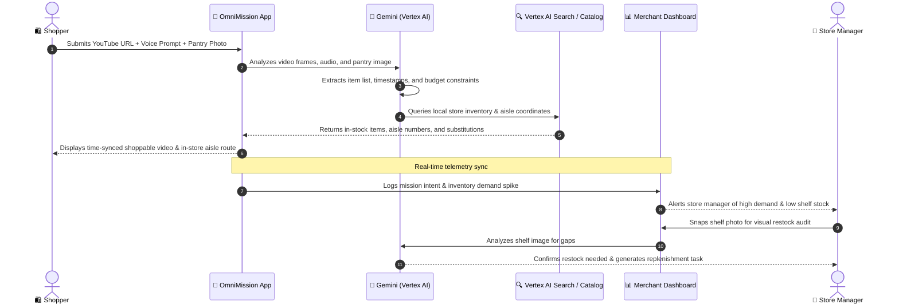

# OmniMission AI
**Multimodal Social-to-Shelf & Phygital Commerce Engine**

---

## 1. Introduction
**OmniMission AI** bridges the gap between social inspiration, digital convenience, and physical store shopping. 

Instead of searching for individual items one by one across multiple sites, shoppers complete goal-driven "missions" using **YouTube videos, voice, and photos**. The system orchestrates an optimized shopping basket with real-time in-store wayfinding (aisle and shelf locations) and digital fulfillment, while providing store managers with an operational command center to prevent out-of-stock losses and track emerging demand.

---

## 2. What Is It?
OmniMission AI is a dual-sided commerce platform powered by Google Cloud and Gemini:

* **For Shoppers (Mobile Web App):** 
  * Paste a YouTube video or Short (recipe, DIY tutorial, fashion haul).
  * Speak or type constraints (*"Keep under $50, serves 4, gluten-free"*).
  * Snap a photo of a pantry or closet to exclude items already owned.
  * Receive a time-synced shoppable basket, smart substitutions, and an interactive in-store aisle walking route.

* **For Store Managers & Merchants (Command Dashboard):**
  * Real-time radar tracking what social trends are driving local shopper missions.
  * Visual shelf audits (computer vision checks for missing stock or misplaced items).
  * Automated alerts to restock high-demand items before shelves run empty.

---

## 3. Why It Matters (The Problem & Impact)

| Problem | Why It Hurts | How OmniMission Solves It |
| :--- | :--- | :--- |
| **Friction in Social Shopping** | Millions get inspired by YouTube videos, but giving up on finding 8+ individual products leads to high drop-offs. | Ingests video timestamps directly to generate a complete, 1-click shoppable kit. |
| **Physical Store Blind Spots** | 70%+ of retail still happens in physical stores, yet shoppers get lost in aisles and walk out if an item is missing. | Maps exact aisle/shelf coordinates and offers instant in-aisle alternatives. |
| **Retailer Inventory Lag** | Stores react too slowly to viral trends, resulting in costly stockouts and overstocked dead inventory. | BigQuery AI predicts demand spikes from real-time customer missions and automates restock alerts. |

---

## 4. User Stories

### Story A: The Shopper (Alex)
* **Scenario:** Alex is hosting a dinner party tonight. He watches a 45-second YouTube Short for a garlic butter pasta dish.
* **Action:** Alex pastes the video link into OmniMission, taps the microphone, and says: *"Make this for 6 people, one person is gluten-free, budget $45, and I am at the Downtown store."* He snaps a photo of his kitchen counter showing he already has butter and salt.
* **Outcome:** The app excludes butter and salt, selects gluten-free pasta, stays within $41.80, and gives him a step-by-step route through Aisles 1, 4, and 7 to pick up everything in 8 minutes.

### Story B: The Store Associate / Manager (Maria)
* **Scenario:** Maria manages the Downtown grocery branch.
* **Action:** Maria opens her Merchant Command Dashboard. The system alerts her that 24 shoppers within a 5-mile radius recently initiated missions for the same viral recipe, putting heavy demand on Aisle 4 (artisanal pasta).
* **Outcome:** Maria takes a quick photo of the shelf with her tablet. Gemini Vision confirms only 2 boxes remain. The system automatically drafts an internal restock request from the backroom before stock runs out.

---

## 5. System Flow & Actor Diagram

---

## 6. Key Technologies (Google Cloud)
* **Gemini 1.5 / 2.0 (Vertex AI):** Multimodal video reasoning (timestamps, scene items), voice parsing, and photo shelf audit.
* **Vertex AI Search:** Semantic product matching, filtering by local inventory and aisle locations.
* **BigQuery & BigQuery AI:** Aggregated mission demand forecasting, basket affinity analytics, and trend tracking.
* **Cloud Run:** Scalable hosting for the web app frontend and API backend.
